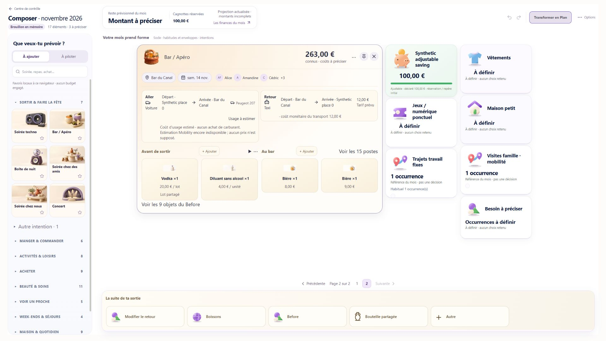
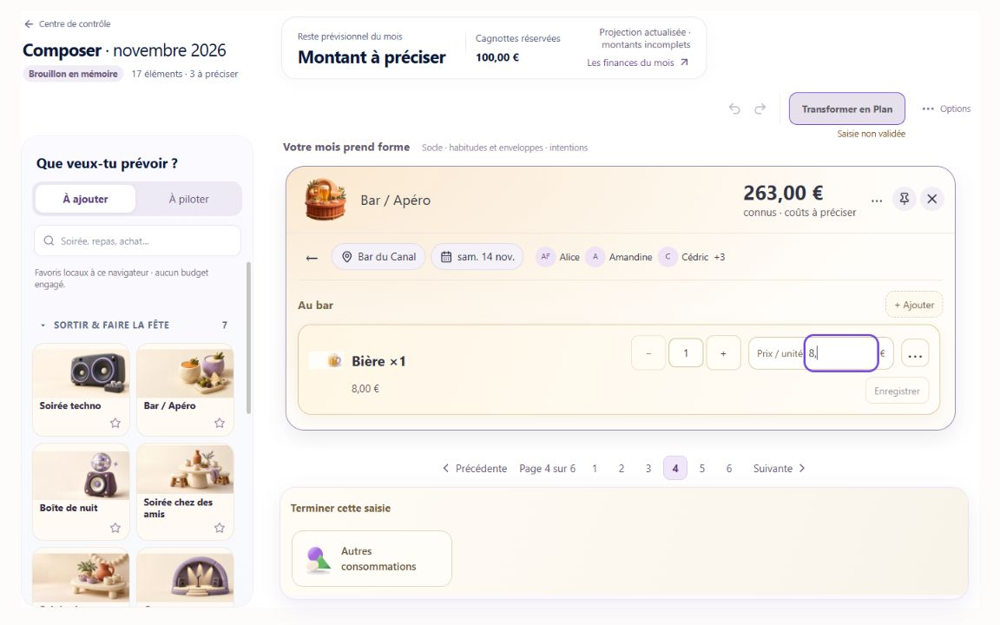

# Bar / Apéro — réception des 16 résidus Google/Mobility

## Verdict : NOT_READY pour réplication

**Développement livré sur la PR Draft #67, dépendante de #66 ; aucune fusion ni Production.** Le raccord prospectif Google → calculateur voiture partagé fonctionne en fixture, sans création Canonical. Six recommandations sont closes au niveau local annoncé. **340/350 closes ; 6 PARTIAL, 2 BLOCKED_OWNER, 2 BLOCKED_ENV.** Les 334 entrées acquises et R337 HTTP Auth sont conservées à l'identique.

Le blocage Auth reste concret : H1 n'a pas de publication Global et le scope Canonical ne désigne pas H1. Aucun compte fictif réactivé, aucune publication, migration, écriture financière ou Apply distant. R209 requiert également un contrat d'admission Canonical absent. Le navigateur et Vercel sont accessibles ; cela ne rend pas ce World isolé admissible.

## Git et déploiements

- Départ : `264dfce70e3c94248ccb691d8348da8020cd84c7`.
- Base PR #66 inchangée : `d25ead9f3c8b2033c038491ce9262fa82e787171`.
- Main distant inchangé lors du contrôle final : `bd97a33d0e4280b7796e941148057b7693af0229`.
- Google : `d2701a0` ; Mobility : `8b8adfa` ; couverture économique/UX : `de586af` ; sonde : `cf5ba1c` ; correction d'un appel de test : `ec85e59`.
- **SHA produit final : `7b9e11199d098a3e56fe4fe39f8c439f1b7d879f`.** V2 `ec85e59` ne diffère de `cf5ba1c` que par un appel de test. V3 rétablit une seule condition de filtre des endpoints (R143), retestée spécifiquement. Les neuf scènes et le parcours Google/60+12/Undo sont des preuves V2, pas des captures prétendument rejouées intégralement en V3. La compatibilité des chemins inchangés est justifiée par le diff conservé.
- PR : [#67](https://github.com/adriensauvageot34/Budgetisation/pull/67), OPEN/Draft, base `codex/bar-apero-350-reconciliation`, pas main.

| Porte | Commit | Preview / déploiement | Build | Preuve fonctionnelle distante |
|---|---|---|---|---|
| V1 | `8b8adfa` | [Google/Mobility](https://budgetisation-5kds8kzdl-adriensauvageot34-6137s-projects.vercel.app) · `dpl_i8mDSYjeKUfEgvERhnKh1DUvpgHt` | READY | Connexion observée ; Auth/provider H1 NOT_RUN |
| V2 | `ec85e59` | [Candidat intégré](https://budgetisation-hkhz9y8yw-adriensauvageot34-6137s-projects.vercel.app) · `dpl_CpGS22ZxR29YMKwM8zL9xtS3xCiv` | READY | Connexion observée ; Auth/provider H1 NOT_RUN |
| V3 / finale | `7b9e111` | [Correctif R143 final](https://budgetisation-2qyas1vcu-adriensauvageot34-6137s-projects.vercel.app) · `dpl_ENdnsTfEAxLnuqUpDhSWK9HzmuLx` | READY | Connexion observée ; filtre d'endpoint retesté en navigateur local ; Auth/provider H1 NOT_RUN |

Vercel retourne `target=null` pour ces déploiements Git Preview sur la branche non Production. Build V2 Next **16.2.6 complet** : compilation **29,4 s**, TypeScript **31,5 s**, statiques **8/8**, `Build Completed`, `Deployment completed`. Ce n'est pas seulement une compilation Turbopack. [Extrait du journal](evidence/bar-apero-350/residual16/vercel-build-excerpt.log).

Build V3 complet : compilation **48 s**, TypeScript **49 s**, statiques **8/8**, `Deployment completed`. [Journal V3](evidence/bar-apero-350/residual16/vercel-v3-build-excerpt.log). Bundle React local et TypeScript locaux : exit 0 sur `7b9e111`. Le filtre R143 a aussi été retesté dans le vrai navigateur local sur ce bundle : proposition absente pour une recherche incompatible, présente pour « Bar texte », puis sélection explicite. [Preuve V3](evidence/bar-apero-350/residual16/v3-browser.json), [diff produit V2→V3](evidence/bar-apero-350/residual16/v3-product-diff.patch).

## Code réellement développé

### A. Référence Google prospective ; B. admission Canonical séparée

`ProspectivePlaceRef` reste KNOWN/TEXT. `night-out-venue@v1` conserve uniquement l'ID de décision, le repère utilisateur, `{provider, kind:BAR_APERO, placeId}` et la provenance explicite. Pas d'adresse complète, coordonnées, photo ou dump Google persisté. Le parseur du template admet et versionne ce champ ; le digest, les éditions partielles et la sérialisation le conservent. Le champ technique n'est pas exposé comme formulaire texte générique.

La fiche propose **« Retenir ce bar pour ma sortie »**, avec un nom libre secondaire facultatif. Details doit correspondre à l'ID demandé et au type Bar ; les réponses tardives/429/retry sont testées par P3. Le matching Canonical reste exact et privé aux identités déjà admissibles ; le DTO ne publie pas un mapping injecté sans autorité.

**R209/R210 restent BLOCKED_OWNER** : `referentiel_lieu` ne publie aucun mapping Google, et aucun writer d'admission officiel utilisable n'a été trouvé. La proposition révisable contient signature, droits, source/génération, unicité, CAS, erreurs, relecture et tests dans [owners.md](evidence/bar-apero-350/residual16/owners.md). Aucun faux KNOWN et aucun writer parallèle n'ont été créés.

### Mobility : même propriétaire que Déclarer une dépense

`prospective-mobility-pricing.ts` transmet au **même `estimatePlannedCar()`** des endpoints Google dirigés. `venueEndpoints.origin/destination` porte une relation explicite/versionnée ; aucun rapprochement par texte ou coordonnées ne la crée. Aller : Google en destination ; retour : Google en origine. Chaque jambe garde sa sélection et son identité. Les références Google ne s'appliquent ni aux trajets autonomes ni à tous les `ROOT_PLACE`.

L'owner relit Details `BAR_APERO`, utilise temporairement l'adresse pour **TomTom**, puis réutilise les owners **SP95 officiel/HERE** existants. Un endpoint Google explicite ne prend pas silencieusement d'anciennes coordonnées manuelles. Mauvais ID/type/adresse manquante : coût UNKNOWN, aucune route inventée. Les trajets Builder existants gardent leur contrat.

Le changement de bar affiche **Conserver les trajets / Adapter les trajets liés** avant mutation. L'adaptation invalide uniquement les points et coûts concernés ; une seule opération, un Undo. Les trajets non liés et tarifs indépendants restent inchangés. Un trajet encore incomplet avec `stops=[]` est admis : le contrôle de cohérence des arrêts ne s'applique que lorsqu'ils existent.

Le lecteur véhicule utilise la déclaration exacte du producteur Canonical (`canonical/vehicle-profile.ts`), sans regex de découpage : présentation **Peugeot 207**, descriptif moteur/modèle dans les détails et libellé complet conservé. Aucun autre modèle n'est inféré. Après endpoints décidés, le dock propose explicitement le véhicule. La carte expose les distance/durée/litres réellement produits par l'owner, avec coûts d'usage distincts des achats de carburant.

### Finance : portée économique explicite

`component-economic-scope@v1` distingue `AGGREGATED_SUBSTITUTIVE_ESTIMATE` et `ADDITIVE_CONTRIBUTION` avec `coveredSelectionIds` exacts. Le parseur COMPONENT vérifie propriétaire, unicité et absence de chevauchement avec un autre poste vivant. Les manifestes historiques sont conservés ; le nouveau manifeste n'est choisi que pour les nouveaux contrats.

`substituteNightOutCoverage` produit une édition atomique avec digest attendu du composant. Il retire uniquement le regroupement choisi, conserve les autres IDs/sockets, refuse une couverture legacy ambiguë ou financée et détecte un rejeu périmé. Le regroupement inverse demande les postes précis à remplacer et une confirmation nominative ; aucune contribution non sélectionnée ne disparaît. Les montants restent calculés exclusivement par Compiler/Finance V2.

## Réception S01–S09 et niveaux réels

| Cas | Résultat exécuté | Limite |
|---|---|---|
| S01 même établissement réel | NOT_RUN | H1 non admissible ; parité owner seulement en mock |
| S02 Google non Canonical → voiture | PASS domaine + navigateur local | TomTom/SP95/HERE simulés, aucun PASS fournisseur réel |
| S03 Canonical exact/admission | Exact/absent/ambigu/privé PASS en React ; admission BLOCKED_OWNER | Mapping réel non publié |
| S04 changement de bar | Conserver/adapter/Undo natifs PASS ; jambe autonome/prix conservés en domaine | Pas de session Auth H1 |
| S05 60 + 12 | PASS domaine/React/navigateur ; les 60 seuls sont remplacés par UNKNOWN, 12 et trajets conservés ; Undo natif restitue 60 | Before 20 et autres sockets conservés dans les tests de domaine ; pas d'Apply réel |
| S06 Save/Reload et conflits | FRESH/SAVED puis Reload local PASS ; nouveau contrat Apply/Reload PGlite PASS ; perte de réponse/refus/timeout Save séparés PASS service | Auth riche UI NOT_RUN ; R337 antérieur inchangé |
| S07 desktop | 9 scènes V2, 4 largeurs effectives ; 2 scènes endpoint V3 à 1440 px ; aucun débordement interne ni collision observée ; RAW/focus PASS | Scènes inchangées qualifiées par le diff, pas réétiquetées comme nouvelles captures V3 ; zoom natif125 NOT_VERIFIABLE ; pas de test mobile |
| S08 mesures | Event Timing, ResourceTiming et transitions de sauvegarde/Preview séparés | Série exploratoire locale, pas un benchmark Auth ni un gain de performance |
| S09 régressions | P1/P2/P3/P4, Planner Mobility, PlannedCar, Draft service, TypeScript, build Vercel, parité PASS | Voir les tentatives échouées conservées ; aucune certification globale annoncée |

**MOCK / LOCAL_BROWSER_FIXTURE : PASS au périmètre décrit. VERCEL_BUILD_READY : PASS. VERCEL_AUTH_BROWSER, REAL_GOOGLE, REAL_TOMTOM, REAL_HERE, AUTH_SAVE_RELOAD : NOT_RUN. NATIVE_ZOOM_125 : NOT_VERIFIABLE.** Le canari HTTP JWT antérieur n'est ni rejoué ni converti en preuve UI.

### Défauts et échecs conservés

1. **Régression du nouveau validateur corrigée** : il rejetait une liaison au bar si le trajet avait une route encore vide. Reproduit dans le premier smoke ; correction puis parcours final admis avec FRESH/SAVED.
2. **Assertion P4 adaptée au nouveau contrat** : l'agrégation exige désormais une sélection exacte ; le vieux bouton de remplacement global ne suffit plus. Les montants attendus restent 16/30 et les goldens sont inchangés.
3. **Appels de test corrigés** : wrapper `{items}` donné à une édition exigeant un tableau, puis `stops` absent d'un mock d'affichage. Les journaux initiaux sont conservés ; aucune correction financière pour satisfaire ces fixtures.
4. **Assertion waves corrigée, retest ciblé PASS** : elle attendait qu'une contribution remplace le regroupement existant. Elle vérifie désormais deux postes distincts et le regroupement intact ; le test legacy sans discriminant est conservé explicitement. Le retest a aussi supprimé une navigation de fixture vers un bouton absent en scène summary.
5. **Régression R143 corrigée en V3** : la proposition du bar central ignorait une recherche d'endpoint non correspondante. Une condition de filtre a été rétablie, puis le test R143 est PASS. Les 25 autres groupes waves ont passé dans la campagne précédente ; C1 et R143 ont été rejoués séparément, sans prétendre à une nouvelle campagne globale des 27 groupes. Les FAIL initiaux sont conservés.
6. Les clics pendant une transition du Board ont parfois ciblé un nœud détaché : reprise après lecture de l'état, sans forcer de clic ni masquer l'erreur. Les captures finales sont rattachées à leur onglet et aux largeurs effectivement lues ; les premières captures d'un autre onglet ne servent pas de preuve 1728 px.

### Mesures, sans promesse de gain

Sur le parcours local synthétique, avec suites locales concurrentes et automatisation Codex : **35 événements Event Timing mixtes**, médiane **864 ms**, étendue **24–4480 ms**. Ce n'est ni le temps SQL, ni la durée de réaction visuelle isolée de chaque geste, ni une campagne comparable avant/après. Aucun objectif de fluidité n'est certifié sur cette série défavorable.

ResourceTiming : **13 requêtes fixture MUTATE/Preview**, médiane **242,9 ms**, étendue **154,1–724 ms** ; **12 Draft HTTP locaux**, médiane **12,5 ms**, étendue **5,1–25,8 ms**. Pas de P95 robuste sur ces groupes hétérogènes. Les transitions démontrent des voies distinctes : une sauvegarde n'est pas une Preview et aucune des deux n'est Apply. Aucune attente >10 s n'a été isolée dans ces requêtes. [Mesures brutes](evidence/bar-apero-350/residual16/metrics.json).

**R335 = HISTORICAL_INCIDENT_UNEXPLAINED** : la cause de l'ancien échec personnel reste inconnue ; aucun timeout Canonical n'est utilisé comme explication automatique d'un Save.

## Matrice, preuves, suite minimale

- [Matrice des 16 entrées originales](evidence/bar-apero-350/residual16/matrix-16.md), [transitions](evidence/bar-apero-350/residual16/transitions-16.json), [tests et SHA](evidence/bar-apero-350/residual16/tests.json).
- **Finance : 22 scénarios × 9 empreintes = 198/198**, rejouées sur `7b9e111`, aucune édition des goldens.
- [Géométrie et focus](evidence/bar-apero-350/residual16/geometry.json), [parcours Google local](evidence/bar-apero-350/residual16/google-browser.json), [Undo réel](evidence/bar-apero-350/residual16/undo-browser.json).
- Tous les fichiers produit touchés se lisent dans `git diff 264dfce ec85e59 -- src`. Les chemins majeurs : `night-out-venue.ts`, `component-economic-scope.ts`, `night-out-edit.ts`, parsers/registry, `planned-car-estimation.ts`, `prospective-mobility-pricing.ts`, lecteur véhicule, `bar-place-search.tsx`, `bar-living-editor.tsx`, `bar-living-operations.ts`, `bar-living-details.tsx` et sonde opt-in.

**Suite indispensable :** préparer chez Global/Canonical un World entièrement fictif H1 officiellement admissible, puis la recette UI réelle avec Google/TomTom/HERE et Save/Reload ; revoir séparément le mapping/writer Canonical. L'action exacte et les validations requises sont dans [owners.md](evidence/bar-apero-350/residual16/owners.md). Pas de réplication du pilote avant R348/providers sûrs. Aucune nouvelle architecture, généralisation ou fusion entreprise.

