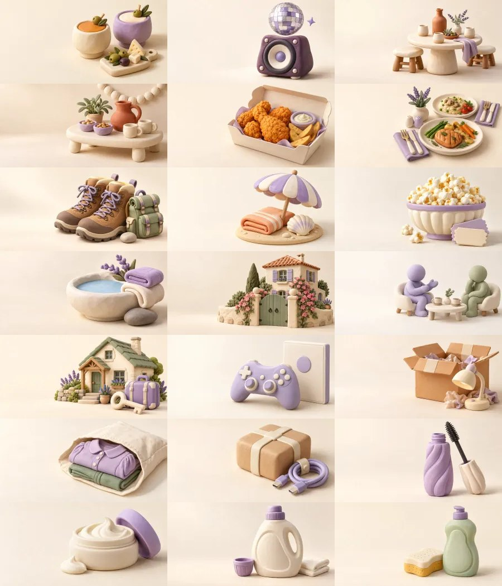

# L2-B — Bibliothèque d’intentions Composer

## État de livraison

**L2B_IMPLEMENTED_NOT_RELEASED** — 21 nouveaux presets et 21 WebP originaux implémentés, 5 presets L2-A conservés. PR #45 prête pour livraison, build final et smoke authentifié Preview PASS. Production encore à exécuter.

## A. État initial et périmètre

- Production/main initial : `c5d33fc6117417e83d66d2ec6c3348bc7df01937`, PR #44.
- Départ local propre : `04967a3860d6511ca38fbc71a4397db5e559c72e`, descendant de main, clôture documentaire L2-A conservée.
- Branche : `codex/composer-v3-l2b-intentions-library`.
- Étape UX : `5680882`. Recettes et illustrations : `0639072`. Corrections ciblées et preuves : `6a60f12`.
- Aucun changement de migration, schéma, SNAP-3, source financière, readWorld, règle du Compiler ou calcul Finance V2.

### Provenance et destination des assets

| Type | Origine faisant autorité | Destination |
|---|---|---|
| 13 Contexts autonomes | Context Registry, assets et capacités serveur | À ajouter, intention générique dans sa catégorie |
| 5 presets L2-A + 21 L2-B | Recettes déclaratives liées à un Context publié | À ajouter, catégorie utilisateur |
| PlanControl | Capability réellement publiée | À piloter → focaliser/ouvrir sa carte existante |
| Saving/Reservation | Owner du mois et protections P08 | À piloter → ajuster si admis, consulter si protégé |
| 114 slot options | Sockets du Context Registry | Palette du parent : Compléter / Autres options |
| Personnes, lieux, produit/besoin | Sélecteurs et owners existants | Questions de l’éditeur ; aucune copie dans le catalogue |
| Context externe read-only | Intention externe déjà compilée | À piloter, référence en lecture seule |

## B. Nouvelle bibliothèque

Deux espaces persistants pendant la séance : **À ajouter / À piloter**. Titre « Que veux-tu prévoir ? ». Neuf catégories réellement peuplées ; Santé et Ma voiture sont absentes tant qu’aucun parcours autonome correspondant n’est publié.

Une seule catégorie ouverte au repos ; deux colonnes ; six entrées maximum avant « Tout voir ». Les sections fermées ne montent aucune vignette. Les 13 Contexts génériques restent atteignables, dont Cadeau derrière Tout voir / recherche.

Recherche locale indexée et mémorisée par modèle, accents/casse normalisés, synonymes explicites. Aucune recherche Supabase ni simulation par frappe. « lave-vaisselle » ne fabrique pas un preset : aucun résultat spécialisé admissible actuellement, achat libre via le Context Achat.

Épinglage volontaire dans localStorage versionné, liste de clés limitée à 100 à la relecture ; message explicite « Favoris locaux à ce navigateur ». Un échec de stockage est signalé ; aucune promesse de synchronisation entre appareils. Aucun montant, contact ni état sémantique sauvegardé dans ce stockage.

À piloter réutilise les capabilityRef des cartes. Courses ouvre son éditeur, digest et nombre de cartes inchangés. Un contrôle protégé reçoit le focus sans ouvrir de faux formulaire.

Palette : Configurer ouvre l’éditeur réel ; Compléter garde une présentation compacte ; Autres options rend tous les choix admis et propose une recherche. Le test de conservation retrouve **114/114 anciennes options**, zéro perte. Les routes enfants supplémentaires expliquent 124 identités de routes retrouvées. Une option déjà équipée ouvre désormais sa sélection existante pour modification, au lieu de tenter un déplacement sur elle-même.

Navigation native clavier, recherche par /, Entrée pour ajouter le premier résultat, flèches dans la liste, focus visible, clic alternatif au drag. Le drag générique et les sockets R6 sont conservés ; les presets utilisent le clic pour transmettre leur identité exacte.

## C. Catalogue de livraison

« LIVRÉ dans le candidat » décrit le périmètre existant et testé, sans promettre un sous-modèle métier absent.

| Preset | Clé stable | Context | État | WebP octets |
|---|---|---|---|---:|
| Bar / Apéro | bar-apero | night-out | LIVRÉ dans le candidat | 20890 |
| Boîte de nuit | nightclub | night-out | LIVRÉ dans le candidat | 23776 |
| Soirée chez des amis | friends-evening | night-out | LIVRÉ dans le candidat | 28480 |
| Soirée chez nous | home-evening | night-out | LIVRÉ dans le candidat | 30898 |
| Snack / Chicken | chicken-snack | fast-food | LIVRÉ dans le candidat | 34430 |
| Restaurant à deux | restaurant-for-two | restaurant | LIVRÉ dans le candidat | 39508 |
| Randonnée / Nature | hiking-nature | activity | LIVRÉ dans le candidat | 42492 |
| Journée plage | beach-day | activity | LIVRÉ dans le candidat | 24286 |
| Cinéma | cinema | activity | LIVRÉ dans le candidat | 27250 |
| Spa / Détente | spa-relax | activity | LIVRÉ dans le candidat | 24538 |
| Visite Servian | servian-family-visit | family-visit | LIVRÉ dans le candidat | 58022 |
| Voir des amis | visit-friends | friend-visit | LIVRÉ dans le candidat | 18830 |
| Week-end / Gîte | weekend-gite | short-stay | LIVRÉ dans le candidat | 44888 |
| Acheter un jeu vidéo | video-game-purchase | purchase | LIVRÉ dans le candidat | 16366 |
| Amazon | amazon-purchase | purchase | LIVRÉ dans le candidat | 26648 |
| Shein | shein-purchase | purchase | LIVRÉ dans le candidat | 30062 |
| AliExpress | aliexpress-purchase | purchase | LIVRÉ dans le candidat | 20160 |
| Mascara | mascara | beauty-restock | LIVRÉ dans le candidat | 14796 |
| Cire coiffante | hair-wax | beauty-restock | LIVRÉ dans le candidat | 14762 |
| Lessive | laundry-detergent | purchase | LIVRÉ dans le candidat | 14048 |
| Liquide vaisselle | dishwashing-liquid | purchase | LIVRÉ dans le candidat | 11962 |

### Limites fonctionnelles explicites

- Bar, Boîte et soirées : éditeur Soirée P09, composants et participants volontaires, bouteilles partagées, aller/retour seulement choisis. Aucun trajet chez-nous/chez-nous.
- Snack : guide réutilisé avec meal/fast-food et capacités officielles. Aucun champ fictif « sur place/livraison ».
- Restaurant à deux : guide L1 ; deux participants ne sont jamais imposés et le total ne se multiplie pas.
- Activités : guide existant ; pas de billet, réservation ni fréquence implicite.
- Servian : éditeur Visite P10 ; aucun proche ou lieu canonique déduit du titre.
- Voir des amis : éditeur des champs structurés et palette du friend-visit publié ; pas de nouveau guide propriétaire.
- Gîte : éditeur Séjour P11 ; prix global/per night selon contrat, trajets facultatifs, pas de taxes ni enfants ajoutés.
- Amazon/Shein/AliExpress : merchantLabel texte choisi, aucun fournisseur certifié. Domaine budgétaire modifiable via les seules choices publiées. « Décider plus tard » conserve les valeurs déjà choisies.
- Mascara/Cire : intention beauté et composants products avec selectionId, label, UNKNOWN, besoin lié facultatif. **Pas de SKU beauté certifié** : le validateur productAssetRef est réservé aux familles de produits Soirée. Il n’est ni élargi ni contourné. Aucun inventaire, prix ou cadence. Produit nommé et prix configurés dans le socket officiel.
- Lessive/Vaisselle : Purchase avec productLabel explicite et home-small ; rattachement uniquement selon Compiler. Pas d’enveloppe Lessive ni stock.
- Aucun développement L3/L4/L5/L6 ni trajet autonome supplémentaire.

## D. Illustrations originales

21 fichiers nouveaux ; **23 appels image_gen individuels**, deux premières versions écartées (Bar et Chez nous trop transparentes). Inspection individuelle puis planche commune. Style Clay mat, ivoire/crème/lavande, lumière haut gauche, contact doux, sujets à droite, aucun texte/logo. Les maisons sont symboliques.

Export proportionnel d’originaux 1774×887 exactement 2:1 vers WebP 1200×600 Q82, sans recadrage ni déformation. Total final : **567092 octets**.

| Clé / fichier sous public/planned-visuals/composer/presets/ | Format | Octets | SHA-256 |
|---|---|---:|---|
| bar-apero | 1200×600 Q82 | 20890 | `b051b9410ec699144a82ef7e9b434f62e152300b7c17ffc1e5f2d5f1ac826a75` |
| nightclub | 1200×600 Q82 | 23776 | `240781cad91144de2be34ad87fbd4a88c73ef8c9223032c2e02c771e13744b75` |
| friends-evening | 1200×600 Q82 | 28480 | `58779ec254552561dd8b32242955882edbc745d1d38b0b55933c692fa7341b4f` |
| home-evening | 1200×600 Q82 | 30898 | `2eb5cf96af4054fa166326ca37f2ad9a6345503376633d5a3180fea72a77125c` |
| chicken-snack | 1200×600 Q82 | 34430 | `83d15ea41ce969a363eb5826a61f4196ff0fa47264603263d4e1d79da1215586` |
| restaurant-for-two | 1200×600 Q82 | 39508 | `2656000b6309090158eb58f3a005e3f838a201f5b535e86b58935bd9e20a4050` |
| hiking-nature | 1200×600 Q82 | 42492 | `209a6a3cb5135c340ba8252e1f316566080ebe2da849d657b814a0368210c1f4` |
| beach-day | 1200×600 Q82 | 24286 | `84d9ddf35df42b8e7eadbeb5a2a9da214770c1597782c77aed016f94d48b91e7` |
| cinema | 1200×600 Q82 | 27250 | `84c2bfd4e2f03d03631e26091e059b6a8282dca63ff1aa74388e979da2a4175b` |
| spa-relax | 1200×600 Q82 | 24538 | `fc1c1e14ec2f68e64aff65596ee57ebcd4f2035ad8fa70d8eb5b22d11b0bdd74` |
| servian-family-visit | 1200×600 Q82 | 58022 | `451b7fc0544600c5cc2d1f3710664487de7c6c0e8b220127a68db5d5fab60edc` |
| visit-friends | 1200×600 Q82 | 18830 | `7f7828c4da281d0419081f231289a683c13277235aa8e6feaf7c4a62f72b7a53` |
| weekend-gite | 1200×600 Q82 | 44888 | `c6f77e04a886600028497adf2c4ba0dbb7c7b41cc79184f766c6533abb46d506` |
| video-game-purchase | 1200×600 Q82 | 16366 | `efba8cb6f487da89355053efea14787befcef54e68c52222f899240e84c5f60e` |
| amazon-purchase | 1200×600 Q82 | 26648 | `5ea1156b64719f50a6965882cb9e94d536cb11dd3e1be293ce5298bed7235041` |
| shein-purchase | 1200×600 Q82 | 30062 | `fc674211ce0645af723791a926601a37abe0ef8d085535fd3ed99f51ff7a8ce4` |
| aliexpress-purchase | 1200×600 Q82 | 20160 | `02edfb1cf78c8a64c8309ed36c59982d90098142f2f9c2b911bf91d85a99cac5` |
| mascara | 1200×600 Q82 | 14796 | `b61d89171e417ddfb835126215da6d51c39b34bfffe5725348140140e6771b4b` |
| hair-wax | 1200×600 Q82 | 14762 | `9016816ccae9767a19467d4187cfda0e75098b0fb5c765ece2abacef59c6efb4` |
| laundry-detergent | 1200×600 Q82 | 14048 | `383cc436a6ff4f9ac6e6296a4ef91443a0f5442e3c8afd569c4921f75f1f16bb` |
| dishwashing-liquid | 1200×600 Q82 | 11962 | `226786ecf9e21395183249a736e780d852ab2556e691efba0f78906cfc69868c` |

Prompts exacts : `evidence/l2b-composer-library/prompts/<clé>.txt`. Original natif, SHA source, nombre de générations, fichiers écartés et inspection : `illustrations.json` / `generation-sources.json`. Outil natif utilisé ; aucun stock, ancien Builder recyclé ou montage présenté comme création individuelle.

Les cinq WebP L2-A gardent leurs octets et SHA d’origine. Une carte renommée lit toujours la même illustration par presetKey.

## E. Compatibilité et conservation

Contrat `composer-context-presentation@v1` conservé, sans nouvelle version ni migration C0. Même constructeur de champs de création locale/serveur. Une clé future inconnue reste conservée en JSON et reçoit la présentation générique ; elle n’accorde aucune capacité de création ou de guide. Version invalide, metadata malformée ou clé connue d’un autre template : refus explicite.

Anciens Plans sans preset lisibles ; cinq clés L2-A inchangées. Les tests L2-A sont limités explicitement à leurs cinq clés historiques et ajoutent le fallback futur sans supprimer la validation de version.

Les 26 tests création/édition/conservation/UNKNOWN/parité ont tous été réellement exécutés avant la correction du scénario de test parent/enfant. Preuve `contract-26-presets-run.log`. Le second passage reprend uniquement les contrôles restants avec le même état synthétique complet : admission Fast-food, scopes, options, enfant Séjour, Apply/Reload/Mon Plan, images. `contract-remaining.log`.

## F. Finance et protections

- Création des 26 presets locale = serveur ; zéro composant économique initial.
- Parité scénario, composants et prix Mobility contre l’équivalent manuel, pour chaque recette.
- Total 40 € avec deux participants reste 40 € ; aucune quantité ou itinéraire supposé.
- UNKNOWN et zéro testés séparément ; suggestions PERSONAL_SUGGESTION non comptées comme décision.
- Séjour avec Restaurant enfant via DROP officiel : un seul hébergement et un seul repas, parent non additif.
- Apply → PlanRevision C0 immuable → Reload → Mon Plan → réédition : **PASS PGlite synthétique uniquement**.
- État World fixture inchangé ; appels réseau serveur interdits par la suite.
- L1, L2-A, C8, P12, P13, Kernel, Draft HTTP, scheduler, B3 : **PASS**.
- Parité historique **22×9 PASS**.
- P09/P10 : anciennes assertions de libellés déjà en échec et reproduites sur la base L2-A. Non rejouées intégralement ici ; aucune nouvelle certification de leurs portions non exécutées.
- Aucun Apply réel, writer Purchase/Operation/PlannedExpense/Wallet/Mobility/MonthInputs, nouvelle campagne RLS authentifiée ou hash exhaustif des finances réelles.

## G. Performance, build et SNAP-3

Comparaison locale bornée, React production minifié/split, mêmes dépendances/styles, viewport effectif 1440×900, Semantic Draft vide, cache chaud, délai artificiel Preview 500 ms, trois paires alternées. Deux processus de fixture isolés. Horloge navigateur + double requestAnimationFrame, jamais chronométrage de l’outil.

| Mesure descriptive | L2-A | L2-B |
|---|---:|---:|
| Ouverture → FRESH P50, n=3 | 1 535,3 ms | 1 522,8 ms |
| Étendue | 1 196,7–1 752,3 ms | 1 132,3–1 873 ms |
| JS initial demandé, 5 ressources | 437 250 octets | 450 420 octets |
| Somme gzip des ressources | 138 758 octets | 142 373 octets |
| DOM initial | 1 899 | 1 906 |
| Images de presets demandées au repos | 5 | 5 |
| Requêtes métier fixture (reprise + Preview) | 2 | 2 |

Le surcoût JS mesuré est +13 170 octets bruts / +3 615 gzip, pas 21 imports d’éditeurs. Aucune collection complète montée au repos. Images servies depuis le cache dans cette série : 0 octet retransféré ; octets décodés distincts des transferts.

Cette mesure a précédé le dernier champ Achat dans le chunk différé et la régénération du WebP Chez nous ; aucun gain chiffré sur l’arbre final n’est revendiqué. Éditeur Restaurant à froid : 1 013,3 / 1 195,9 ms, un seul essai chacun, incluant l’ajout et l’import sur les serveurs synthétiques. Recherche/sections : traces brutes `performance-interactions.json`, séances non parfaitement appariées et fortes variations de scheduling ; pas de comparaison P95 ni cible UX certifiée. Pas de régression de montage massif ni de requête financière visuelle observée.

TypeScript local : **PASS**, build Next complet Vercel sur `0639072` : **PASS / READY**, compilation 36,6 s, TypeScript 38 s, pages générées. Tête produit finale `6a60f12cbe933d1493207e7767a580fa91d2837f` : **PASS / READY**, compilation 36 s, TypeScript 35,6 s, pages et build complet terminés. Le build Next local reste limité par la jonction node_modules hors racine Turbopack déjà documentée ; aucun contournement.

SNAP-3 : aucun fichier d’admission/artifact/trigger/config/lecture historique modifié. Pas de republication, nouveau World ni cache serveur.

## H. UX et navigateur

### Fixture isolée réellement exécutée

- 1440×900, 1728×900, 1920×1080 mesurés dans le DOM ; zéro débordement horizontal global.
- Neuf catégories, sections fermées non montées, cinq images initiales. Tout voir conserve le Cadeau générique.
- Recherche accentuée/non accentuée et création au clavier.
- Favori Mascara puis Spa conservé après Reload, retrait volontaire possible ; aucune mutation sémantique du favori.
- À piloter : Courses ouvre la carte existante, nombre=1 et digest inchangé ; Café protégé consultable sans formulaire modifiable.
- Mascara : ajout, produit UNKNOWN, libellé personnalisé, SAVED/FRESH, Reload, modification depuis la palette.
- Amazon : article, merchantLabel Amazon, home-small et montant 18 € conservés après Undo/Redo pendant Preview puis Reload ; même digest retrouvé.
- Gîte : éditeur P11 chargé ; Voir des amis : champs personne/participants/lieu/date et palette ; Snack : guide et budget.
- Captures : avant, 1440 initial, 1728 Activités, 1920 Achats, À piloter/Courses, Mascara repris, Amazon repris.
- Les copies d’écran de fixture ne sont pas présentées comme authentifiées.

### Preview authentifiée

Sur `dpl_78y3L7p3nXQCaSNMPSfro3owYLXX` / `0639072` : session Budgetisation réelle, catalogue et guide Snack ouverts ; montant 24 € volontairement saisi en mémoire, traité par le Compiler, affiché sans multiplication ni trajet. Projection BLOCKED pour les autres informations manquantes, aucune erreur affichée. L’autosauvegarde Preview reste désactivée par configuration ; **save/reload authentifiés Preview NOT_RUN**. Aucun changement de protection ni Apply.

## I. Livraison et rollback

PR : https://github.com/adriensauvageot34/Budgetisation/pull/45

Preview initiale : https://budgetisation-md2vo9mkp-adriensauvageot34-6137s-projects.vercel.app

Tête produit finale : `6a60f12cbe933d1493207e7767a580fa91d2837f`. Preview `dpl_DuUcZ9ouCpXvyjVnZ8CHbPTCqve6` READY : https://budgetisation-ogf90vlb3-adriensauvageot34-6137s-projects.vercel.app

Smoke authentifié de cette tête : Amazon conserve son vendeur texte et expose les quatre domaines publiés + inconnu ; Cire ouvre l’éditeur Beauté et sa palette après retour du Compiler. Apply reste désactivé, aucune erreur affichée. Sauvegarde Preview désactivée, save/reload authentifiés NOT_RUN ; preuve `preview-authenticated.json`. GitHub/Vercel success.

État au présent rapport : merge et Production non exécutés. Les gates produit locaux et Preview sont satisfaits ; livraison autorisée avec réserves de validation documentées.

Rollback : masquer les recettes de création et revenir à la présentation précédente tout en gardant **le lecteur v1, les 26 clés et les fichiers d’illustration** pour les Drafts/Plans enregistrés. Ne pas redéployer aveuglément une ancienne version qui refuse des clés nouvelles. Aucun DELETE, SQL ou perte d’archive nécessaire.

## J. Inventaire et suite

`master-asset-inventory.json` recense les **370 mappings Builder (326 choix + 44 alias)**, les 26 recettes et les intentions futures explicitement citées. EXISTANT désigne une capacité réellement disponible ; les lots L4/L5/L6 restent des propositions de classement, pas des fonctionnalités livrées.

Restaurant/Cadeau/Visite/Séjour existent. Concert/Festival/anniversaire : recettes futures L4 ; vêtements/produits spécialisés : capacités génériques à exposer ; santé/entretien auto : L5 ; stock et consommables spécialisés : L6. Aucun inventaire ni SKU inventé dans L2-B. Trajet autonome et frais administratifs spécialisés restent à exposer avec leur owner.

Réserves héritées : timeouts Canonical timing/57014 intermittents ; performances réelles et P95 non certifiés ; Apply personnel interdit et non exécuté ; nouvelle campagne RLS et second appareil physique NOT_RUN. Aucune reprise de ces chantiers pendant L2-B.

STOP après livraison L2-B ; aucun L3 commencé.
