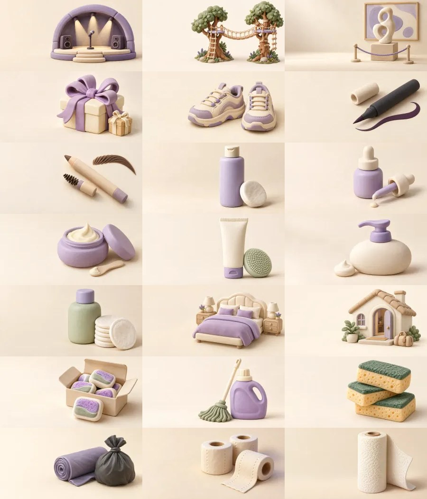

# L3.2 — Rationalisation et enrichissement de la bibliothèque Composer

## Verdict de préparation — 16 octobre 2026

**L3_2_IMPLEMENTED_NOT_RELEASED** au stade de clôture de la PR #48. Les 21 nouveaux presets sont admis, illustrés individuellement et vérifiés sur fixtures. Build Next du produit `045d64926fa77fb054269e1ac157c0e55e1092cc` PASS/READY. Livraison et smoke à consigner après exécution réelle.

## A. État de départ

- Main et Production vérifiés : `3bde89c423d38f61f458b643c264f5f9424e1393` (L3.1, PR #47). Main distant inchangé au démarrage.
- Clôture documentaire locale `4d73f29` préservée par fast-forward, sans modification produit ni réécriture.
- Branche : `codex/composer-v3-l3-2-library-rationalization`.
- Catalogue initial : 26 presets illustrés, 13 génériques, neuf catégories peuplées, 114 options en palette. Les génériques étaient concaténés aux presets et rendus au même niveau.
- Recherche locale par accents/casse ; favoris `budgetisation.composer.library-favorites.v1`, locaux au navigateur. Contrats v1 et clés historiques conservés.
- Références consultées : rapports L2-B, L3, L3.1 ; inventaire maître historique L2-B (370 mappings Builder). Cet inventaire reste une preuve historique ; le catalogue L3.2 est dans `evidence/l3-2-composer-library/catalogue.json`.

## B. Rationalisation réalisée

| Famille | Choix concrets au premier niveau | Recours conservé, en secondaire |
|---|---|---|
| Sortir | Cinq presets historiques + Concert | Autre soirée |
| Manger | Uber Eats, Snack / Chicken, Restaurant à deux | Autre livraison, Autre repas rapide, Restaurant libre |
| Activités | Cinq historiques + Accrobranche, Musée / Exposition | Autre activité |
| Acheter | Choisir un achat / Acheter chez… : produit et vendeur distingués | Autre achat, Cadeau libre |
| Beauté | Maquillage, Cheveux, Visage, Autres soins | Autre soin |
| Visites | Fontès, Servian, un seul Voir des amis principal | Autre visite familiale, Autre visite amicale |
| Week-ends & séjours | Gîte, hôtel, proches | Autre séjour |
| Maison | Huit consommables concrets | Autre projet maison |
| Imprévus & autres | Aucun faux preset spécialisé | Autre intention |

Les 13 génériques ne sont pas supprimés. Accès « Intentions libres », recherche, favoris et drag officiels conservés ; petites lignes au lieu de grandes vignettes concurrentes. Les catégories avec beaucoup de presets gardent six vignettes au repos, puis Tout voir. Une seule catégorie ouverte hors recherche. Les sections fermées ne montent pas leurs illustrations.

Les sous-titres sont des groupes de présentation, pas des domaines financiers. Shein reste une information de vendeur d’un seul Achat ; Vêtements mensuel reste dans À piloter. Recherche normalisée aussi sur les séparateurs ; classement privilégie le libellé exact. « Éponge » n’est plus un synonyme trompeur de Liquide vaisselle. Toutes les anciennes clés de favoris restent identiques, y compris celles des génériques ; les inconnues ne sont pas supprimées du stockage.

## C. Les 21 nouvelles recettes

Toutes utilisent le contrat `composer-context-presentation@v1` existant, une identité stable et une capability publiée. Aucun prix, quantité, personne, date, trajet, financement, stock ou composant économique initial automatique.

| Clé | Libellé | Famille | Context | Defaults métier supplémentaires | Illustration | Statut |
|---|---|---|---|---|---|---|
| `concert` | Concert | SOCIAL | `activity` | Label d’intention uniquement | `concert.webp` | LIVRÉ candidat |
| `ropes-course` | Accrobranche | ACTIVITY | `activity` | Label d’intention uniquement | `ropes-course.webp` | LIVRÉ candidat |
| `museum-exhibition` | Musée / Exposition | ACTIVITY | `activity` | Label d’intention uniquement | `museum-exhibition.webp` | LIVRÉ candidat |
| `gift-present` | Cadeau | PURCHASE | `gift` | Label d’intention uniquement | `gift-present.webp` | LIVRÉ candidat |
| `shoes-purchase` | Chaussures | PURCHASE | `purchase` | productLabel=Chaussures, budgetDomain=clothing | `shoes-purchase.webp` | LIVRÉ candidat |
| `eyeliner` | Eyeliner | BEAUTY | `beauty-restock` | Label d’intention uniquement | `eyeliner.webp` | LIVRÉ candidat |
| `eyebrow-pencil` | Crayon à sourcils | BEAUTY | `beauty-restock` | Label d’intention uniquement | `eyebrow-pencil.webp` | LIVRÉ candidat |
| `facial-toner` | Toner / Tonique | BEAUTY | `beauty-restock` | Label d’intention uniquement | `facial-toner.webp` | LIVRÉ candidat |
| `face-serum` | Sérum visage | BEAUTY | `beauty-restock` | Label d’intention uniquement | `face-serum.webp` | LIVRÉ candidat |
| `face-moisturizer` | Crème hydratante | BEAUTY | `beauty-restock` | Label d’intention uniquement | `face-moisturizer.webp` | LIVRÉ candidat |
| `face-cleanser` | Nettoyant visage | BEAUTY | `beauty-restock` | Label d’intention uniquement | `face-cleanser.webp` | LIVRÉ candidat |
| `care-lotion` | Lotion de soin | BEAUTY | `beauty-restock` | Label d’intention uniquement | `care-lotion.webp` | LIVRÉ candidat |
| `makeup-remover` | Démaquillant | BEAUTY | `beauty-restock` | Label d’intention uniquement | `makeup-remover.webp` | LIVRÉ candidat |
| `hotel-night` | Nuit à l’hôtel | TRAVEL | `short-stay` | lodgingKind=HOTEL | `hotel-night.webp` | LIVRÉ candidat |
| `stay-with-relatives` | Séjour chez des proches | TRAVEL | `short-stay` | lodgingKind=RELATIVE | `stay-with-relatives.webp` | LIVRÉ candidat |
| `dishwasher-tablets` | Pastilles lave-vaisselle | HOME | `purchase` | productLabel=Pastilles lave-vaisselle, budgetDomain=home-small | `dishwasher-tablets.webp` | LIVRÉ candidat |
| `floor-cleaner` | Nettoyant pour le sol | HOME | `purchase` | productLabel=Nettoyant pour le sol, budgetDomain=home-small | `floor-cleaner.webp` | LIVRÉ candidat |
| `sponges` | Éponges | HOME | `purchase` | productLabel=Éponges, budgetDomain=home-small | `sponges.webp` | LIVRÉ candidat |
| `trash-bags` | Sacs-poubelle | HOME | `purchase` | productLabel=Sacs-poubelle, budgetDomain=home-small | `trash-bags.webp` | LIVRÉ candidat |
| `toilet-paper` | Papier toilette | HOME | `purchase` | productLabel=Papier toilette, budgetDomain=home-small | `toilet-paper.webp` | LIVRÉ candidat |
| `paper-towels` | Essuie-tout | HOME | `purchase` | productLabel=Essuie-tout, budgetDomain=home-small | `paper-towels.webp` | LIVRÉ candidat |

**Beauté : intention suggérée par le preset ≠ produit économique sélectionné.** Le contrat n’autorise pas un productAssetRef beauté certifié arbitraire. Les huit nouveaux presets gardent leur nom et leur identité de présentation ; le vrai produit se choisit explicitement dans le socket Produits & besoins, avec selectionId, label et prix UNKNOWN ou renseigné. Aucun SKU ni médiane inventé. Le guide explique cette limite.

Maison/Chaussures conservent productLabel et domaine déjà admis. Hôtel/Proches utilisent le choix lodgingKind publié par P11, sans gratuité ni hébergement économique automatique. Le test navigateur montre un repère visuel Hébergement, tandis que la relecture du Draft confirme bien `slotSelections: {}`.

## D. Illustrations originales

- **21 appels natifs image_gen individuels**, 21 sélections, une tentative chacune. Pas de stock, ancien Builder, recoloration ou montage présenté comme une création.
- Clay mat ivoire/crème/lavande, éclairage haut gauche, sujets distincts, aucun texte/logo ; originaux natifs 1774 × 887, ratio 2:1.
- Export proportionnel WebP **1200 × 600 Q82**, sans recadrage ni déformation. Total livré **418 352 octets**.
- Les 26 fichiers historiques gardent leurs SHA. Les 47 illustrations ont des SHA distincts.
- Prompts exacts : `evidence/l3-2-composer-library/prompts/`. Manifestes : `generation-sources.json` et `illustrations.json` : original, SHA natif, WebP/SHA, taille, tentatives et inspection.
- Les originaux restent dans le dossier natif Codex, avec copies locales sous `outputs/l3-2-clay-originals/` (hors Git). Les WebP, prompts et manifestes sont versionnés.
- Inspection individuelle des sorties natives, puis des WebP et de la planche commune : silhouettes et produits reconnaissables, notamment toner/pipette/pot/tube/pompe, papier toilette/essuie-tout. Pas de visuel rejeté nécessaire.
- Premier export bloqué par la résolution locale de sharp ; utilisation de la dépendance déjà fournie par le runtime Codex, sans installation ni nouvelle dépendance produit.

## E. Tests et compatibilité

### Contrats nouveaux — EXECUTED_PASS_PGLITE_SYNTHETIC_ONLY

`node scripts/check-l3-2-library.mjs` : **26 contrôles PASS**, dont les 21 recettes individuellement : vrai DROP serveur = état local immédiat, capabilities, champs vides honnêtes, prix UNKNOWN, édition partielle, identités, sérialisation et snapshots Undo/Redo. Comparaison batch au scénario manuel équivalent : mêmes scénarios, composants et prix Mobility, 21 contributions de 40 € lorsque choisies explicitement, aucun trajet. UNKNOWN distinct de zéro. **Apply → PlanRevision → Reload → Mon Plan → réédition PASS sur PGlite seulement.** Aucun JWT ni Supabase réel simulé comme authentifié.

### Régressions — quinze suites EXECUTED_PASS

L3.1, L3, R6 P4/P4.5/présentation, B0/B1, L1, L2-A, L2-B restant, C8, P13, Kernel, Draft HTTP, scheduler P2, parité historique **22 scénarios × 9 empreintes**.

Adaptations des anciens tests explicitement motivées :
- L2-B isole ses 26 clés historiques et vérifie le total courant séparément ; l’ancienne absence de lave-vaisselle est remplacée par la présence correcte de Pastilles ; six presets sociaux au repos au lieu de cinq.
- Les longues boucles historiques déjà PASS ne sont pas déclarées réexécutées : mode REMAINING_ONLY, traces antérieures conservées ; les 21 nouveaux cas sont réellement exécutés séparément.
- Les gardes L3/L3.1 excluent uniquement les deux registres de présentation de leur contrôle global de non-modification du domaine. Tous les owners financiers, transport Draft, scheduler, Apply et SQL restent gardés. Aucun golden financier modifié.
- Le runner copie les résultats dans le dossier L3.2 puis restaure les preuves historiques à leurs octets initiaux.
- **114 options publiées, 124 routes accessibles, aucune manquante.** Contrôles À piloter toujours uniques.
- TypeScript local PASS, Next complet Vercel PASS. Aucun changement serveur, Finance V2, Compiler, Constraint Engine, CAS, Preview, PlanRevision ou SNAP-3 ; aucune migration ni dépendance produit ajoutée.

### Navigateur desktop — EXECUTED_PASS_LIMITED_FIXTURE

- Sept ajouts prioritaires réellement cliqués : Eyeliner, Sérum visage, Pastilles, Éponges, Cadeau, Concert, Séjour chez des proches ; bons éditeurs, sept identités distinctes.
- Produit Eyeliner choisi par le socket officiel, label et 12,50 € explicitement saisis. SAVED/FRESH ; après Reload, même produit/prix et identité, réédition depuis le Board fidèle.
- Même digest avant/après Undo/Redo et Reload : `8edfaaaadc1c7c75c3ccf68caa7c437b5c8eeb8a92edcfdbbad51503b5be78a4`. Même ensemble de sept IDs et sept illustrations chargées en 1200 px.
- Favoris Mascara historique et Sérum nouveau conservés après Reload ; leur modification ne change pas le digest. Favoris créés pour ce test ensuite retirés de cette origine de fixture.
- Recherche ancienne Mascara, recherche « soirée libre » → Autre soirée, drag générique toujours déclaré, navigation clavier vers les contrôles de résultats.
- Beauté : Tout voir ouvre les dix produits ; Acheter distingue Choisir un achat/Acheter chez… ; Maison expose ses huit consommables.
- Dimensions **réellement mesurées** : 1440 × 900, 1728 × 900, 1920 × 1080 ; largeur bibliothèque 268 px préservée, document jamais plus large que le viewport.
- Deux interruptions d’outil traitées par relecture : fermeture de Cadeau effectivement terminée ; clic Séjour non dispatché, absence de carte vérifiée avant une seule reprise. Aucun double ajout.
- Canaris de fixture : **0 Plan, 0 PlanRevision, 0 RPC Apply, 0 écriture distante** dans le navigateur. Le test Apply isolé précédent utilise une autre base PGlite.
- Aucun nouvel Apply personnel, mutation financière Production, test RLS ou deuxième appareil.

Captures : [avant comparable](evidence/l3-2-composer-library/catalogue-before-1440.jpg), [après comparable](evidence/l3-2-composer-library/catalogue-after-1440.jpg), [Beauté](evidence/l3-2-composer-library/beauty-all-1440.jpg), [Acheter](evidence/l3-2-composer-library/purchase-groups-1728.jpg), [Maison](evidence/l3-2-composer-library/home-consumables-1920.jpg), [réédition produit](evidence/l3-2-composer-library/eyeliner-reedited.jpg). Ce sont des fixtures, pas des données personnelles ou des preuves authentifiées.

## F. Performance ciblée

Même onglet actif, alternance L3.1/L3.2, mêmes 17 éléments, viewport effectif 1440 × 900, React compilé/minifié, mêmes dépendances/CSS et sonde existante performance.now + deux RAF. Aucune suite en parallèle ni IO distante ; échauffements exclus (16,02 / 17,90 s), trois paires prédéfinies conservées. Référence bundle produit 38f5cd9 identique au main L3.1 ; formatage final des nouvelles recettes sans changement sémantique.

| Mesure descriptive | L3.1 | L3.2 |
|---|---:|---:|
| Ouverture → FRESH P50, n=3 | 2 407,9 ms | 2 621,1 ms |
| Étendue | 2 353,2–10 208 ms | 820–7 424,8 ms |
| DOM initial | 1973 | 1941 |
| Ressources initiales | 16 | 17 |
| Images de presets au repos, Board compris | 6 | 7 |
| Fichiers JS initiaux | 5 | 5 |
| JS décodé | 460 454 octets | 472 530 octets |
| JS gzip calculé | 145 241 octets | 147 501 octets |
| Requêtes métier / ouverture | 2 | 2 |
| Réponse modèle | 435 167 octets | 435 167 octets |

Paires : **10 208/2 621,1 ; 2 407,9/7 424,8 ; 2 353,2/820 ms**. Même digest dans les six échantillons. Aucun résultat lent supprimé. Le POST de fixture varie lui-même de 518 à 5 591,4 ms en référence et 285,4 à 2 669,8 ms en candidat ; cela n’explique pas à lui seul toute la latence. Aucun diagnostic P14 relancé.

Ouverture Beauté → double RAF : **23 / 131,9 ms, n=1** ; recherche Mascara/effacement, six gestes chacun : médianes **20,6 / 27,6 ms**, étendues **10,3–26,7 / 12,8–118,7 ms**. Le premier geste candidat défavorable est conservé. La famille affiche davantage de produits ; la part de décodage/rendu et le scheduling ne sont pas isolés.

Surcoût initial **+2 260 octets gzip** et **une** illustration de plus (Concert remplace le générique au premier niveau), pas 21 chargements supplémentaires. Aucun éditeur lourd ajouté au repos, aucune lecture World par tuile ni requête à la frappe. **Aucun gain Production, P95 ou absence générale de régression de latence certifié** sur cette série variable. Les preuves de charge bornée ne constituent pas une certification temporelle.

## G. Livraison et rollback

- PR : https://github.com/adriensauvageot34/Budgetisation/pull/48.
- Produit testé : `045d64926fa77fb054269e1ac157c0e55e1092cc`.
- Commits distincts : `dd8fcbb` rationalisation/recherche/favoris ; `c8cdc00` recettes ; `045d649` illustrations. Tests/preuves dans un commit séparé.
- Preview produit : `dpl_BZH7SJPyJuftkKejwHAeK424nfZy`, **READY**, build Next complet incluant TypeScript, génération des pages et déploiement (`preview-next-build.log`).
- Merge, Production et smoke : en attente de la clôture effective.
- Rollback : masquer les nouvelles recettes de création si nécessaire, tout en conservant le lecteur v1, les **47 clés**, les champs déjà enregistrés et les fichiers d’illustration. La présentation peut revenir séparément au layout antérieur. Aucun DELETE de Draft, migration ou conversion financière. Ne pas supprimer les clés de Plans existants.

## H. Décisions reportées

L4 : wizards conditionnels complexes. L5 : Santé, automobile, trajet autonome, capacités administratives spécialisées. L6 : inventaire/besoins ; L7 : scénarios persistants ; L8 : arbitrages. Aucune de ces capacités n’est présentée comme opérationnelle dans L3.2. Aucun coût ni foyer personnel déduit.

## I. Décision

Les 21 candidats sont compatibles et illustrés ; aucun report de recette nécessaire. Les fondations économiques et la conservation sont vérifiées aux niveaux de preuve indiqués. Réserves héritées : persistance authentifiée des nouvelles recettes et P95 réel non certifiés ; timeouts Canonical historiques non investigués ici. La livraison du catalogue reste distincte de ces certifications complémentaires.

**STOP après L3.2. Aucun L4 commencé.**

