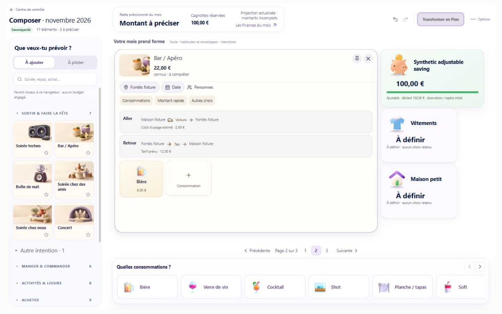
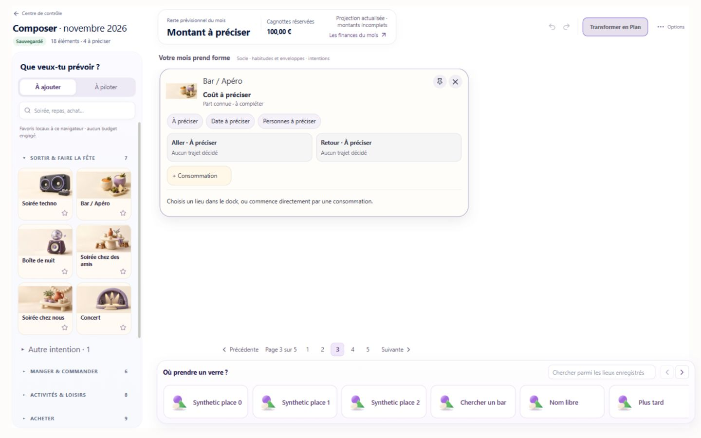

# L4-E — Bar / Apéro V8 — réception produit

Date : 17 octobre 2026. **READY_FOR_HUMAN_UX_REVIEW**, avec les limites ci-dessous. **Pas READY_FOR_GENERALISATION.**

## Livraison et périmètre

- Base réelle de #57 : `9adefff0e97459c4af92c76014bf2eb71f0aea34`.
- Branche : `codex/composer-v3-l4-e-bar-v8`, PR [#58](https://github.com/adriensauvageot34/Budgetisation/pull/58), base #57. Dépendances #54 → #55 → #56 → #57 préservées.
- Commits produit : `bcedb14597662007f4363614fe2606cf4e37ba33`, `1527db22097aa40c169485d85bece615c16f1fb0`, `ac90e5d17ab03f7b1fa7b6b636e80801a37eedc1` (fonctionnalité finale), **`762fbbc3116fd76efb84de0bb9f9e08fac19e0ee`** (finition CSS des champs, code final).
- [Preview immuable du code final](https://budgetisation-1nmzusewc-adriensauvageot34-6137s-projects.vercel.app/mois-a-venir/composer?month=2026-11), `dpl_SNV4bewV2dkS49PQEGjrFL77bQyt`, **READY**, target `null`, Git SHA `762fbbc…`.
- Build Next complet sur cette Preview : compilation, TypeScript, génération des 8 pages statiques, finalisation, déploiement terminé. Dépendances/cache Vercel réutilisés ; pas de revendication d'installation fraîche. Le connecteur ne fournit pas de code de sortie numérique du processus : preuve par journal complet et état READY, pas par la seule compilation Turbopack.
- Le commit documentaire qui ajoute ce rapport ne modifie pas le code testé. Les preuves de build concernent l'URL immuable ci-dessus.
- Aucune fusion, migration, promotion Production, écriture Supabase ou Apply personnel. La PR reste en revue. Les autres 46 presets ne reçoivent pas cette interface.

## Modifications réellement livrées

1. **Bon asset.** Seul `composerPresentation.presetKey=bar-apero` sélectionne la carte vivante. Le clic Library Bar / Apéro a été exercé dans le navigateur ; « Autre soirée » ouvre réellement le panneau historique Configurer Soirée. Les captures de Soirée ne certifient donc pas Bar / Apéro.
2. **Géométrie corrigée.** Le Board réservait encore **426 px** au panneau historique pendant l'édition inline. La suppression est ciblée sur Bar ouvert. Le dock générique est supprimé au repli du Bar, pour rendre sa hauteur au Board. La grille impose maintenant `align-self:stretch` aux cellules : l'ancien alignement hérité laissait des cartes intrinsèques dépasser leurs pistes et chevaucher la suivante. Cette correction géométrique mécanique bénéficie aux voisines ; elle ne généralise pas l'atelier V8.
3. **Carte lisible.** Illustration, titre ouvrant le résumé, date française, initiales/prénoms et deux micro-itinéraires indépendants. Les tuiles utilisent les symboles du catalogue publié. Suppression visible et Undo ; boutons `+` et navigation directe. Une dernière valeur serveur reste explicitement « précédente » pendant le recalcul ; aucune nouvelle somme n'est calculée par React.
4. **Saisie locale.** Mini-éditeur dans la tuile sélectionnée, quantité/prix regroupés, calendrier du mois et personnes embarqués. Les autres choix riches restent accessibles dans l'atelier existant embarqué. La bière est admise quantité 1 / UNKNOWN avant de saisir un prix. Zéro explicite reste différent de UNKNOWN.
5. **Coût rapide explicite.** « Entrées / contribution » est additif, hors consommations/repas/trajets. « Consommations regroupées » remplace leurs détails, hors repas/before/trajets. L'ajout d'un détail en présence d'un coût principal demande de choisir remplacement ou supplément indépendant. Le remplacement utilise une seule mutation existante, sans inventer de marqueur de couverture financière ni de plafond. Ce n'est pas un total universel couvrant toute la sortie.
6. **Trajets dirigés.** Identité du leg publiée dans le DTO d'affichage via l'`ownerIntentId` existant, facultatif pour compatibilité. Évite d'afficher le coût de l'autre sens en prenant arbitrairement le premier résumé. Voiture = coût d'usage, jamais plein payé. Retour explicite sans copie de tarif/parking/financement. Changement de lieu invalide seulement les preuves dépendantes.
7. **RAW conservé pendant le reflow.** La réception a découvert une perte réelle : un changement de page après redimensionnement remontait l'éditeur V7/V8 initial et effaçait le prix RAW. Corrigé par un unique conteneur de portail éphémère par carte ouverte, possédé par Shell ; la grille déplace ce conteneur, sans remonter l'éditeur. Aucune persistance locale sensible ni nouvel état métier. Échap rejoint la confirmation existante. Le conteneur et ses écouteurs sont supprimés à la fermeture autorisée.
8. **Recherche de lieu.** Un champ principal, ville contextualisée uniquement si un lieu connu la justifie, modification possible. Plusieurs identités locales pour le même Google ID nécessitent un choix. Erreurs réseau/429 et réponse HTML non JSON deviennent des messages compréhensibles. Résultats obsolètes ignorés, token de session renouvelé après détail.

## Réception navigateur : méthode et résultats

Navigateur officiel Codex, vraies interactions DOM et captures. Application React minifiée avec chunks, `NODE_ENV=production`, composants produit, Compiler/V2 et stockage synthétique existants. **Ce serveur local n'est ni Supabase authentifié ni une session d'application Vercel.** Les captures du produit ci-dessous sont celles de ces fixtures locales. Le build complet Next est certifié séparément sur Vercel.

Référence V7 : bundle construit avant modifications au HEAD `9adefff…`, port 3207. V8 initiale ports 3208–3210 ; corrections de repli/recherche 3211 ; focus 3212 ; protection RAW 3213 puis version finale 3214. Chaque anomalie est distinguée de son retest. Les dossiers générés `outputs/` ne sont pas des fichiers produit.

**Limite finale de navigateur :** après les captures et le retest RAW de `ac90e5d`, l'outil officiel a signalé que l'usage local du navigateur était désactivé dans les réglages Work. Aucun autre accès UI n'a été tenté pour contourner cette restriction. Le commit `762fbbc` ajoute uniquement quatre règles CSS scoped pour rendre les champs prix/quantité visiblement éditables (bordure, espacement, étiquettes). Son build complet est vérifié, mais sa présentation finale n'a pas pu être recapturée. Les captures `v8-final-beer-active-1440.png` et `v8-final-compact-1440.png` concernent donc **`ac90e5d`**, avant ces quatre règles, pas `762fbbc`. Une vérification visuelle humaine de cette finition reste requise ; aucune capture de Preview Vercel authentifiée n'est revendiquée.

### Reproduction manuelle ciblée

La Preview ci-dessus exige l'authentification Budgetisation ; ne pas la tester avec un Plan personnel pour fabriquer une preuve isolée. Les tests locaux utilisent `scripts/serve-phase2-planner-composer-fixture.mjs`, `PORT=3215`, `PLANNER_C8_BROWSER_OUTPUT=outputs/l4e-v8-ui-final`, `PLANNER_L1_SPLIT=1`, et les dépendances navigateur déjà installées dans `C:/Users/AdrienSauvageot/Documents/Codex/p14-c4-tools`. Les scénarios sont `/?scenario=L4E_5&durable=1&delayRead=700`, `L4E_16`, `L4E_30`, `L4E_50` ; ils contiennent respectivement ce nombre d'intentions en plus du socle. Le scénario `P10` fournit Maison/lieu connu/Peugeot et les providers synthétiques.

Recette humaine restante, sans Apply personnel : vérifier les champs visibles du commit CSS, choisir Bière, taper un prix RAW puis changer la largeur, confirmer qu'il reste présent ; annuler une fermeture puis abandonner, contrôler que le prix admis reste inchangé ; vérifier zoom navigateur réellement à 125 % et les deux densités non certifiées. Pour l'authentification durable, utiliser seulement un environnement isolé autorisé ; statut maintenu `NOT_RUN_AUTH` jusque-là.

### Géométrie mesurée

- Référence **1440×900 effectifs** : carte ouverte largeur 634,4 px, réservation droite 426 px. Voir `v7-baseline-effective.json/png`.
- Fixture **30 intentions + 16 éléments de socle**, 1440×900 : carte compacte **372,275 × 335 px**, ouverte **754,563 × 525 px**. Aucun chevauchement de rectangles ni débordement global après stabilisation. Page **4/6 → 6/10 → 4/6** ; positions et pistes de toutes les cellules de la page fermée **strictement identiques** après repli (`sameCells=true`).
- Fixture **5 intentions + socle** : repli exact, zéro intersection, focus rendu au bouton Bar / Apéro sur `1527db2`, avant le montage stable RAW. Ce ne sont pas des Boards contenant exactement 5 ou 30 objets en tout : le socle reste affiché.
- Carte ouverte, mesures stabilisées **1440×900, 1600×900, 1728×900, 1920×1080** : zéro intersection, carte dans le viewport, largeur/hauteur de document égales au viewport. Les captures et rectangles sont conservés.
- Les premières mesures prises immédiatement pendant les transitions ont enregistré des coordonnées négatives/intersections transitoires ; conservées dans `desktop-geometry.json`. Elles ne sont pas présentées comme des mesures stabilisées. Les relevés concluants sont dans `desktop-stable-geometry.json`.
- Placement pur : **5, 16, 30, 50 objets**, trois dimensions de grille, conservation de tous les IDs, cellules disjointes, expansion et repli déterministes. Les densités 16 et 50 n'ont pas de certification navigateur exhaustive.
- **Zoom natif 125 % : NOT_RUN.** Le raccourci envoyé n'a changé ni la largeur CSS ni le ratio pixel ; il ne constitue pas une preuve de zoom. Le viewport **1152×720**, équivalent en espace CSS à 1440×900 / 1,25, a été exercé avec dock et défilement interne ; ce test n'est pas renommé « zoom 125 % PASS ».

### Effort et stabilité

Ajout Bière UNKNOWN : **2 commandes dans l'éditeur** (Consommations → Bière), comme V7, contre 4 pour le chemin V6 comparé par les handlers React. V8 ne revendique pas un nouveau gain sur ce nombre. Le progrès est l'édition dans la tuile, le calendrier/personnes intégrés et le retrait du panneau séparé. En navigateur, le chemin passe du dock à la carte, sans formulaire extérieur. Les déplacements de souris en pixels et un P95 de latence produit ne sont pas mesurés ; aucune durée de l'outil n'est utilisée comme métrique produit.

RAW : prix 8 saisi, changement de viewport/page, puis prix toujours 8, question `row`, dirty=true, aucun commit implicite. Le focus automatique après resize peut revenir à un bouton de carte ; le retour dans le champ après annulation de la confirmation a été vérifié. Le focus de frappe continu à travers toute forme de redimensionnement reste une limite ergonomique, sans perte de saisie après correction. Fermeture/Échap → Continuer conserve la valeur et redonne le focus au champ. Confirmation total/détails annulée conserve 30 RAW et les détails ; acceptée remplace les détails ; le vrai Undo restaure la bière et son prix.

## Matrice de réception

`PASS` signifie uniquement le périmètre de preuve écrit sur la ligne. Aucun PASS local n'est assimilé à une certification Supabase ou fournisseur réel.

| ID | Verdict | Preuve / limite |
|---|---|---|
| A1 | PASS local | Clic Library exact, illustration, carte inline, identité/preset conservés après Reload synthétique. |
| A2 | PASS identification | Autre soirée réellement créée ; dialogue historique Configurer Soirée, distinct du Bar. |
| B1 | PASS local délimité | Fixtures 5/30 intentions + socle ; rectangles disjoints, repli exact. Placement pur 5/16/30/50. |
| B2 | PARTIAL | Quatre tailles desktop réelles PASS ; espace CSS réduit exercé ; zoom natif 125 % NOT_RUN, densités 16/50 navigateur non exhaustives. |
| C1 | PASS | Bière quantité 1, UNKNOWN immédiatement, tuile active réelle. |
| C2 | PASS | Passer à Date sans prix n'ouvre pas de RAW et garde UNKNOWN. |
| C3 | PASS local | 8 → 12, sauvegarde locale confirmée, Reload et réédition ; mêmes IDs dans les contrats. |
| C4 | PASS | Serveur calcule 12×2=24, une sélection, affichage navigateur 24. |
| C5 | PASS | Retrait sans RAW puis vrai Undo navigateur ; IDs/prix/quantité restaurés dans les contrôles. |
| C6 | PASS local | 20 regroupés → détails 8+12 = 20 via Compiler ; remplacement 30, annulation/acceptation réelles et Undo ; portée affichée, pas de plafond. |
| C7 | PARTIAL | SHARED et trois participants PASS Compiler/L4-A et V8 ; bouteille riche non parcourue entièrement dans le navigateur. |
| D1 | PASS fixture | Lieu connu → Maison → voiture/Peugeot admissible, coût d'usage 2 € calculé par propriétaire synthétique. Aucune certification TomTom réelle. |
| D2 | PASS fixture | Retour explicite, endpoints inversés, ID distinct, aucun tarif/parking copié. |
| D3 | PASS fixture | Retour seul Taxi 12 ; aller voiture 2 intact ; bière 8 ; total autoritatif affiché 22. |
| D4 | PASS fixture | Nouveau repère textuel : destinations/départs concernés changés, devis/frais invalidés, bière conservée ; contrats conservent les slots indépendants. |
| D5 | PASS local | Origine remplacée par Synthetic place 2, mode Voiture et origine visibles après repli/réouverture. |
| D6 | PASS | Aller seul et retour non décidé visibles ; tarifs inconnus non copiés ni inventés. |
| E1 | PARTIAL | Réponses officielles simulées et KNOWN exact testé ; pas de recherche Google authentifiée réelle. |
| E2 | BLOCKED_CAPABILITY | Pas de writer propriétaire de promotion Google vers lieu Canonical identifié/admissible. Résultat reste transitoire, aucun faux KNOWN. |
| E3 | PASS fixture | 429, obsolescence, réponse JSON invalide, fournisseur Mobility indisponible ; message lisible et choix conservés. |
| F1 | PASS local | Calendrier natif, date humaine, Alice + deux prénoms libres, trois chips ; aucun changement de quantité implicite. |
| F2 | PASS ciblé / PARTIAL navigation | Vraie fermeture/Échap et annulation, focus revenu au prix ; discard et changement de question couverts React. Navigation hors page et fermeture d'onglet non certifiées exhaustivement. |
| F3 | PARTIAL | Reflow/pagination conserve désormais le RAW réel ; retour géométrique exact ; focus de carte et annulation certifiés, frappe continue pendant resize non certifiée. |
| G1 | PASS synthétique / NOT_RUN_AUTH | Sauvegarde HTTP isolée, confirmation puis Reload, champs et IDs ; Apply/PlanRevision/READ sur PGlite. Pas de compte personnel ni de JWT isolé utilisé. |
| G2 | PASS local | 22 scénarios × 9 empreintes = **198/198**, golden inchangé ; Compiler/V2, protections et canaris. Pas de certification financière distante nouvelle. |

## Régressions et builds

Commandes lancées par l'agent ; journaux dans [evidence/l4-e-bar-v8](evidence/l4-e-bar-v8/).

| Commande | Résultat exécuté |
|---|---|
| `node scripts/check-l4-e-bar-v8.mjs` | 16 groupes PASS, renderer React en processus ; reprend/adapte les 13 groupes d'interactions V7 et ajoute les cas V8. Les anciens sélecteurs V7 ne constituent pas un gate UI V8 inchangé. |
| `node scripts/check-l4-d-bar-mobility.mjs` | 6 groupes PASS, vrais Compiler/Kernel/Apply/Reload, providers et base PGlite synthétiques. |
| `node scripts/check-l4-a.mjs` | 19 contrôles PASS, notamment SHARED et participants. |
| `node scripts/check-l4-b-presets.mjs` | 47 presets create/edit/serialize/reload PASS synthétiques, sans prétendre 112 cas UI. |
| `node scripts/check-l4-c-v6-interactions.mjs` | 16 groupes React PASS, dont 47 entrées publiées. |
| `node scripts/check-pre-l4-c1.mjs` | PASS contrats et canaris, finances protégées. |
| `node scripts/check-pre-l4-c2-c8-source.mjs` | C8-017 original PASS ; garde non désactivé/modifié. |
| `node scripts/check-composer-post-snap3-draft-http.mjs` | PASS local mocked service : same-origin, version, récupération après réponse perdue, refus réponse invalide. |
| `node scripts/check-composer-p14-p2-scheduler.mjs` | 5 contrôles PASS, réponses obsolètes/Undo/dispatch ; pas un benchmark réel. |
| `node scripts/check-planner-performance-parity.mjs` | **198 empreintes PASS sur `ac90e5d`**, aucun golden modifié. |
| `npx.cmd tsc --noEmit --pretty false` | Sortie 0 sur `ac90e5d` ; dernière différence `762fbbc` : quatre règles CSS seulement. TypeScript final aussi exécuté dans le build Next. |
| `npm run build` Vercel Preview | **FULL NEXT PASS / READY `762fbbc`**, journal intégral conservé. |

Les contrôles métier avant le dernier correctif RAW sont réutilisés parce que ce correctif touche le montage de l'éditeur, Échap et le CSS de son conteneur. TypeScript, 16 groupes V8, parité et build final ont été rejoués ; la conservation RAW a été vérifiée dans le vrai navigateur. Les avertissements `react-test-renderer` déprécié et `act` des anciens helpers sont conservés dans les logs, pas transformés en preuve navigateur.

## Anomalies conservées et corrigées

| Constat | Correction / retest |
|---|---|
| Réservation droite 426 px pour Bar inline | Scoping CSS ; padding 0 et largeur de carte vérifiés. |
| Voisines débordant leurs pistes dans une page dense | Alignement stretch ; zéro intersection stabilisée. |
| Repli gardait le dock générique et les pages supplémentaires | Dock compact supprimé ; page/cellules initiales exactement restaurées. |
| Google renvoyait une erreur technique JSON dans la fixture sans endpoint | Erreur compréhensible, test JSON invalide et vrai fallback navigateur. |
| Prix RAW 8 perdu lors du resize, `step=summary`, dirty=false | Conteneur stable, même prix et question après déplacement ; preuve avant/après et rejet de toute sauvegarde implicite. |
| Retour de focus perdu par remontage/pagination | Rétablissement ciblé du titre compact ; cancellation rend le champ RAW. Limite de focus après resize explicitée ci-dessus. |

Les échecs initiaux des sélecteurs automatisés (icônes/hints/quantité maintenant dans le nom accessible) ont été adaptés aux contrôles réels, sans affaiblir les assertions économiques. Les premières traces d'échecs et mesures préliminaires sont conservées séparément des résultats concluants.

## Google Place : limite propriétaire et action minimale

Le chemin existant `/api/places/autocomplete` / `details` fournit des informations transitoires, sous authentification/rate limit/context VENUE. Les lecteurs de lieux exposent les identités publiées. Les DTO de préparation de dépenses acceptant Google ne constituent pas un writer autorisé pour un lieu KNOWN Composer ; les writers PlannedExpense sont hors périmètre. Le contrat C0 Composer n'autorise pas de transformer arbitrairement un Google ID en identité Canonical.

Pour lever E2 : identifier/faire approuver l'owner de création de lieu, définir son opération d'admission avec foyer/droits/idempotence/dédoublonnage, puis faire approuver l'évolution C0/adaptateurs/RLS nécessaire avant implémentation. Ce lot n'ajoute ni table, RPC, writer financier ni champ temporaire trompeur. En attendant, sélection d'un lieu déjà publié ou repère libre honnêtement non géocodé.

## Réception humaine et suite

- Tester visuellement la Preview finale sur desktop, puis valider ou corriger l'ergonomie Bar avant toute généralisation.
- Supabase isolé authentifié : **NOT_RUN_AUTH**, aucun environnement dédié admissible utilisé. Aucun compte personnel utilisé pour contourner cette limite. Google/TomTom réels : non certifiés par les mocks.
- À compléter : zoom natif 125 %, frappe/focus continus au resize, densités navigateur 16/50 exhaustives, bouteille complète et navigation hors page. Aucune revendication de P95 produit ou de performance distante nouvelle.
- Rollback : retirer les quatre commits produit de cette seule branche/PR ; aucune migration ni donnée à inverser. Les JSON métier versionnés restent inchangés et les anciennes révisions lisibles.
- **Aucun GO main/Production demandé ou consommé ici.** #58 reste empilée pour revue. Pas de généralisation aux autres presets.

