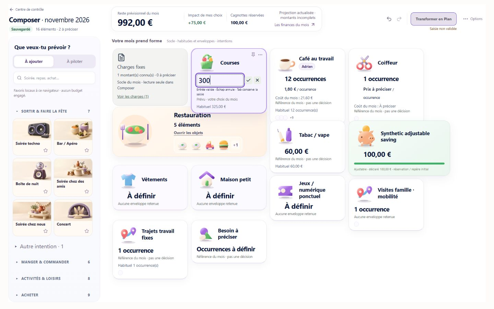

# PRE-L4 C1 — Intégrité des décisions Composer V3

16 octobre 2026. Application desktop. PR de revue uniquement ; aucune fusion ni livraison Production.

## Verdict

```text
PRE_L4_C1 = PASS_WITH_LIMITATIONS
D04_ADMISSION = FIXED
D01_RAW_EDIT = FIXED
AUTH_CYCLE = NOT_RUN
HISTORICAL_COMPATIBILITY = PASS
FINANCIAL_PARITY = PASS
TESTED_SHA = e49fe038ab75d8d117f13158abec32ca797642f2
C1_PR = https://github.com/adriensauvageot34/Budgetisation/pull/50
```

Ces verdicts portent sur les services réels avec données synthétiques, PGlite et le navigateur local React de production. Ils ne constituent pas une certification JWT Supabase. Le build Next complet du SHA testé est PASS et sa Preview est READY.

**C2 peut commencer sur cette base après revue C1.** D02 et D03 restent réservés à C2. Aucun travail C2/L4 commencé.

## 1. Base, branche et traçabilité

- Main redécouvert par fetch : `5cfb1211d114ddaa574f63372cdb9c4cfc7e660d` ; Production L3.3 READY sur ce SHA, inchangée pendant C1.
- Départ local propre : `0e7c892184391f5b434d2d926dbb6e1c60092ce5`, descendant de la clôture documentaire `b38161b31c0df6a25c71c8ab2dcc58489b79c936`. Le code produit était identique à L3.3 ; les preuves A0 sont conservées sans réécriture.
- Branche : `codex/composer-v3-pre-l4-c1-decision-integrity`.
- `6d9d2bee085437cfc087647b6de7d77278a098dd` : admission, compatibilité des lectures immuables, garde inline et lots +/−.
- `e49fe038ab75d8d117f13158abec32ca797642f2` : distinction des erreurs d’admission avant écriture, préparation Mobility dans la preuve historique, sondes reproductibles.
- Les sources UI de ces deux commits sont identiques. Le navigateur utilise le bundle minifié React production correspondant à dix modules vérifiés par leurs `sourcesContent`, avec normalisation CRLF/LF. La seconde modification produit concerne uniquement la qualification serveur des refus avant écriture.

La PR inclut aussi les documents A0 locaux nécessaires au contexte de revue. Aucune modification de SNAP-3, des sources Canonical, des règles Finance V2, de la Baseline, des modèles historiques, des migrations ou du schéma Draft.

## 2. D04 — Admission des nouvelles décisions

### Chaîne et correction

`capabilities du slot → controlFields() → champs publiés → validateControlFieldNumber() → validation MUTATE et materializePlanSlots() → Compiler → Preview → Apply autoritaire`.

Les bornes restent définies par l’owner serveur : count entier de 0 à 9 999, ou 0 à 1 pour un Renewal conditionnel ; possibilité d’un prix explicite uniquement lorsque l’owner la publie. Le validateur numérique pur est partagé avec le validateur MUTATE. Le Compiler contrôle désormais aussi les décisions soumises dans un état complet. La Baseline sans décision n’est ni plafonnée ni réécrite.

Les codes de refus historiques sont conservés. `ControlDecisionAdmissionError`, sous-type de `TypeError`, identifie un refus levé pendant la matérialisation, avant le writer. Le service peut ainsi le présenter comme un refus connu. Une erreur ordinaire du writer portant le même texte reste `COMPOSER_APPLY_UNCONFIRMED` : aucun élargissement global de la liste des erreurs supposées antérieures au commit.

### Avant / après réellement exécuté

Avant : [preuve A0](evidence/pre-l4-audit/admission-boundary.json), Restaurants max9 999, MUTATE refuse10 000, matérialisation et READ complet acceptent10 000. Aucun Apply A0 de ce cas.

Après : [matrice C1 complète](evidence/pre-l4-c1/contracts.json). Les colonnes MUTATE, matérialisation, READ, Preview et Apply proviennent toutes d’appels exécutés. Les Apply admis utilisent le repository et la RPC C0 sur **PGlite synthétique uniquement**.

| Cas | MUTATE | READ / Preview | Nouvel Apply |
|---|---|---|---|
| HOUSEHOLD count9 999 | Admis | READY_WITH_WARNINGS | Commis sur PGlite |
| HOUSEHOLD count10 000 | Refus | Refus par l’owner | Refus avant writer, zéro RPC |
| Fréquence1,5 | Refus | Refus entier | Refus avant writer, zéro RPC |
| Count0 volontaire | Admis | Coût0 | Commis sur PGlite |
| PERSON count12, prix2,10 | Admis | Décision et prix conservés | Commis sur PGlite |
| PERSON count10 000 | Refus | Refus | Refus avant writer |
| Ancien contrôle count-only | Admis | Prix historique reste une référence | Commis sur PGlite |
| Prix UNKNOWN, count2 sans prix explicite | Draft admis | BLOCKED, prix non inventé | Refus Kernel, zéro RPC |
| Prix UNKNOWN, count0 | Admis | Coût0, prix toujours inconnu | Commis sur PGlite |
| Prix UNKNOWN puis prix explicite admissible | Admis | Coût connu par Compiler | Commis sur PGlite |
| Count UNKNOWN sans décision | Sans mutation | Référence inconnue conservée | Aucun Apply artificiel de cette référence |
| Prix non éditable soumis comme override | Refus | Refus de structure | Refus avant writer |
| Floor100, décision100 | Admis | Admis | Commis sur PGlite |
| Floor100, décision99 | Refus | Draft inspectable, BLOCKED | Refus Kernel, zéro RPC |
| Savings protégée | Refus | Draft inspectable, BLOCKED | Refus Kernel, zéro RPC |
| Renewal conditionnel count2 | Refus | Refus | Refus avant writer |
| Renewal conditionnel count0 | Admis | Admis | Commis sur PGlite |

**Admettre une représentation de Draft incomplète ne signifie pas autoriser Apply.** Les floors et Savings gardent leurs contraintes Kernel BLOCKED préexistantes ; ils ne sont pas remplacés par une nouvelle doctrine React. Les bornes publiées ne peuvent plus être franchies par le chemin d’état complet pour obtenir une nouvelle décision applicable.

### Compatibilité historique bornée

Une preuve serveur non sérialisable est construite après vérification des enveloppes persistées et du digest sémantique. Elle est liée au foyer, au mois, au `decisionId` et au contenu exact du contrôle. Un simple objet JSON imitant cette preuve ou une valeur modifiée ne bénéficie d’aucune exception.

La preuve ne dispense que du nouveau contrôle numérique ; les validations historiques restent exécutées. Elle est utilisée dans les lectures officielles et leur préparation Mobility, jamais dans un READ avec `rawDraft`, une nouvelle Preview éditable ou un nouvel Apply.

Test exécuté : reconstruction de l’interpréteur A0 exact, Apply C0 synthétique d’un ancien Restaurants10 000, puis remise du code courant. READ officiel et Mois à venir relisent10 000 avec statut `EXACT`. Le même JSON soumis comme Draft courant est refusé. Une réédition doit ramener la décision dans les bornes actuelles avant un nouvel Apply ; aucune troncature automatique. Le rejeu de l’ancien requestId restitue la même révision sans RPC supplémentaire. Preuve forgée et contrôle changé à10 001 : refusés.

## 3. D01 — Texte brut distinct de la décision

### Correction

Un registre éphémère d’édition remonte seulement identité du champ, dimension, état RAW/PENDING et callbacks. Il ne reçoit pas le texte saisi. Aucun nouveau Draft sémantique, stockage de frappes, scheduler, recalcul ou sauvegarde n’est créé.

- Un champ ouvert ou un lot +/− en attente bloque Apply, y compris son handler, et affiche « Saisie non validée ».
- SAVED/FRESH peuvent continuer à décrire l’ancienne décision ; la notice distingue la saisie visible.
- Enter/Valider confirme une mutation explicite. Il faut ensuite une Preview fraîche et une sauvegarde confirmée pour Apply.
- Escape/Annuler abandonne seulement le texte brut ; Tab/blur le conserve.
- La fermeture de groupe ne vise que les identités des champs de ce groupe. Le refus conserve les éditeurs ; l’accord abandonne sans mutation.
- Undo/Redo demande un abandon explicite si un éditeur brut subsiste. Si un lot +/− est encore en attente, il est d’abord transmis ; Undo n’annule pas silencieusement une décision plus ancienne.
- Le garde `beforeunload` inclut ces champs et lots, même si le Draft officiel est déjà SAVED. Les actions de remplacement/rechargement du Draft tiennent aussi compte du registre.
- Un +/− déjà cliqué reste une intention explicite : flush unique avant saisie manuelle, fermeture de groupe, début de drag, ou après démontage. Le démontage n’annule plus silencieusement son timer350ms.

La notice est placée hors du flux du bandeau pour ne pas redimensionner le Board à chaque entrée/sortie de saisie. Une première implantation dans les métadonnées du titre provoquait une recomposition pendant un essai ; elle a été remplacée avant le commit produit. Ce changement ne traite pas D02/D03.

### Preuves navigateur

[27 observations navigateur](evidence/pre-l4-c1/browser-checks.json), [identité du bundle](evidence/pre-l4-c1/browser-bundle-identity.json), [état serveur synthétique](evidence/pre-l4-c1/browser-server-state.json). Aucun message console de niveau erreur relevé sur les cinq onglets contrôlés ; cela n’est pas une affirmation sur les logs de Production.

Cas central du code publié : Courses250, SAVED/FRESH, Apply disponible. Texte300 non validé : **Apply désactivé**, notice visible, digest inchangé `7bb4fea9…`. Aucune mutation du simple texte. Une confirmation300 déclenche ensuite Preview PENDING et SAVE ; la validation invalide `2,345` affiche une erreur, jamais zéro.



| Transition | Résultat exécuté / limite |
|---|---|
| Enter et Valider | Confirmation explicite vérifiée ; Preview/SAVE puis FRESH/SAVED |
| Escape et Annuler | Abandon sans mutation ; digest conservé |
| Tab, blur, panneau financier | Texte et garde conservés |
| Redimensionnement desktop | Largeurs réellement observées1440 et1728, hauteur900 ; texte conservé |
| Board40, page1→3→1 | Champ brut maintenu, Apply bloqué |
| Deux cartes de titre « Repas travail » | Deux identités PERSON et deux textes5/7 indépendants |
| Groupe : refus Fermer / Détails / Ajuster | Trois branches React exécutées, texte conservé, pas d’inspecteur ouvert |
| Groupe : accord | Abandon sans mutation ni changement de digest |
| Undo sur texte brut | Accord explicite puis abandon, ancien historique correctement restauré |
| Rafale réellement rapprochée de deux + |300→310 ; un seul Undo retrouve300, Redo retrouve310 |
| Lot +/− puis page |325→335 conservé sur Board dense |
| Lot +/− puis saisie manuelle |335→340 transmis, champ manuel initialisé340,00 ; pas de double écriture |
| Lot puis fermeture/remontage de groupe | Count2→3 conservé ; pas de demande d’abandon d’un texte brut inexistant |
| Démontage avant échéance350ms | Sonde du vrai composant : events initialement vide, un unique SET_STATE sur A à255 ; remontage255, B de même libellé reste50 |
| Modification pendant Preview PENDING | Deux décisions successives admises ; Apply reste bloqué |
| Texte brut pendant SAVING | Texte2,20 présent et Apply bloqué ; ancienne sauvegarde ne confirme pas le texte brut |
| CAS Draft à deux clients | Serveur simulé :255 chargé dans les deux onglets ;260 sauvegardé par le premier ;275 du second reste local en CONFLICT, Apply interdit ; chargement explicite du serveur retrouve260 |
| Drag natif et reprise après drag | NOT_RUN : pas de primitive native drag utilisable sur les onglets DOM de cet environnement |
| Confirmation JavaScript native, fermeture/rechargement refusé | NOT_RUN natif ; ne pas confondre avec les branches React testées par stub |

**Limite de confirmation :** `a0Confirm=decline|accept` est un stub du host synthétique, repris explicitement pour les branches React. Aucun PASS de fenêtre native n’en est déduit. La navigation/recharge après sauvegarde confirmée et l’archivage ont été exécutés ; le refus natif de quitter avec texte brut reste à contrôler dans un navigateur exposant ces dialogues.

Contrôle manuel natif restant : ouvrir la même fixture sans `a0Confirm`, saisir300 sans valider après Courses250 SAVED/FRESH ; annuler un rechargement et vérifier le texte conservé et Apply interdit. Dans le groupe Restauration, saisir une fréquence5 sans valider : refuser sa fermeture doit conserver le champ ; accepter ensuite l’abandon ne doit pas modifier le Draft. Pour le drag, déplacer au pointeur une carte en cours de réglage et vérifier l’identité, le flush unique et Undo/Redo. Ces contrôles ne nécessitent aucune donnée personnelle.

Les clics coordonnés pendant certaines animations ont parfois manqué le champ ciblé dans l’outil. Aucun résultat n’est déduit de ces tentatives. Les essais concernés ont été exécutés au clavier sur les contrôles identifiés, avec lecture de l’état DOM après chaque transition utile. Aucun temps de l’outil n’est présenté comme latence produit.

## 4. Conservation et authentification

Cycle synthétique réellement exécuté dans le navigateur : Café13 puis14, prix2,10 ; count15 pendant Preview retardée, prix2,20 pendant SAVING ; attente de confirmation, rechargement :15 et2,20, même identité, SAVED. Modification du count seul16, Undo15 puis Redo16 pendant PENDING : prix2,20 conservé. Archivage récupérable par Options → Abandonner mes essais → Confirmer.

État serveur final : archive du même Draft, version6, count16, unitAmount2,20, provenance `EXPLICIT_USER_DECISION`. Les quatre scénarios navigateur ont chacun **0 Plan, 0 PlanRevision, 0 RPC Apply, 0 écriture distante et canaris historiques intacts**. Ce transport est une fixture locale ; la régression distincte de la route Draft HTTP utilise un service simulé.

`C1-03 = NOT_RUN_AUTH`. Aucun compte isolé actif et admissible n’était disponible dans le contexte autorisé. Le seul compte navigateur connu est personnel ; les comptes F0 restent désactivés. Aucun compte réactivé/créé, aucune écriture sur un Draft personnel, aucun Apply réel, aucun changement RLS. Le cycle JWT count/prix, relecture, count seul, Undo/Redo, archive reste à exécuter avec un compte de test explicitement admissible. Les preuves ci-dessus ne le remplacent pas.

## 5. Validation et écarts honnêtes

Toutes les lignes suivantes correspondent à des exécutions C1, pas à des PASS repris d’un ancien rapport.

| Contrôle | Résultat / preuve |
|---|---|
| Contrats C1 | PASS, six groupes ; [journal final](evidence/pre-l4-c1/contracts-final.log) et matrice18 lignes |
| TypeScript | PASS exit0, dont sonde TSX ; [journal](evidence/pre-l4-c1/typecheck-final.log) |
| Kernel | PASS40 contrôles ; journal initial et recontrôle final ciblé après qualification des erreurs |
| Simple Levers / protections | PASS30 ; voir incident de code d’erreur ci-dessous |
| Renewal | PASS32 |
| P13 Apply/CAS/idempotence/relecture | PASS8, rejoués après le dernier changement serveur |
| Draft HTTP | PASS5, `PASS_LOCAL_MOCKED_SERVICE_ONLY` ; aucune preuve JWT |
| Scheduler | PASS5 synthétiques, versions et réponses hors ordre |
| L3.3 | PASS11 groupes, count/prix/UNKNOWN, protections et Apply/Reload PGlite |
| L3.1 UX | PASS8 contrats locaux |
| Parité | PASS22 scénarios ×9 domaines,198 empreintes inchangées ; [journal final](evidence/pre-l4-c1/parity-final.log) |
| Build Next normal | PASS sur e49fe03, Preview `dpl_58AdQKMVoKeLxgFMnNpw6wrMqe2o` READY : npm run build → next build16.2.6, compilation24,7s, TypeScript25,8s, génération8/8 et optimisation terminés, build Vercel54s ; [journal intégral final](evidence/pre-l4-c1/vercel-next-build-final.log). Le premier build6d9d2be est également conservé. |
| Auth réel isolé | NOT_RUN_AUTH |
| Dialogues et drag natifs | NOT_RUN |

La première campagne de neuf suites finit exit1 : l’assertion Simple Levers attendait `SIMPLE_OCCURRENCE_COUNT_MUST_BE_INTEGER`, remplacé prématurément par un refus numérique générique. L’ordre a été corrigé pour préserver les codes historiques ; **la même suite a ensuite passé30 contrôles, exit0**. Le premier journal en échec est conservé avec le journal du rejeu. Aucun golden financier modifié et aucune assertion financière assouplie.

Le garde de périmètre de L3.3 conserve sa liste explicite ; seuls les chemins serveur C1 de lecture/admission ont été ajoutés à cette liste. Les assertions économiques, les contrôles UNKNOWN/prix et les canaris n’ont pas été changés.

Le premier lancement C1 synthétique a également rencontré `spawnSync git EPERM` lors du chargement de l’interpréteur historique. Les exécutions autorisées ont réussi ; aucune protection contournée. Les builds distants réutilisent le cache normal Vercel, sans prétendre à une installation fraîche des dépendances. Pas de campagne P95 ni de nouveau benchmark P14.

## 6. Statut des tickets A0 et réserves

| Ticket | Statut C1 | Suite |
|---|---|---|
| D04 / C1-02 | FIXED | Admission actuelle cohérente ; anciennes révisions lisibles |
| D01 / C1-01 | FIXED | Garde Apply et transitions testées ; limites natives explicites |
| C1-03 | NOT_RUN | Compte JWT isolé admissible manquant |
| D02 / C2-01 | NOT_RUN dans C1, défaut A0 conservé | Référence présentée comme décision : C2 |
| D03 / C2-02 | NOT_RUN dans C1, défaut A0 conservé | Chevauchement compteur inconnu : C2 |

Les réserves natives/authentifiées restent visibles pour C3 et la future revue de livraison. Aucun résultat de conservation ou de parité inattendu, aucune perte de choix confirmé démontrée sur les parcours exécutés.

## 7. Reproduction, rollback et arrêt

Contrats : `node scripts/check-pre-l4-c1.mjs`. Régressions : `node scripts/check-pre-l4-c1-regressions.mjs`. Le wrapper préserve les anciens fichiers de preuve et range les nouveaux résultats sous `evidence/pre-l4-c1`.

Navigateur complet : compiler la fixture existante avec `PLANNER_L1_SPLIT=1`, `PLANNER_C8_BROWSER_OUTPUT=outputs/pre-l4-c1-candidate`, le chemin esbuild déjà installé et le CSS global existant, puis servir la version précompilée via `scripts/serve-pre-l4-audit-fixture.mjs`, port3216. Scénarios `L1_L33_C1`, `L1_L33_DENSE_C1`, `L1_L33_C1_GROUP` et `L1_L33_C1_ASYNC`, `durable=1` ; délais bornés `delayRead=5000&draftDelay=3000` pour le dernier. Le stub de confirmation est uniquement le paramètre explicite `a0Confirm` de ce host synthétique.

Sonde de démontage : `node scripts/serve-pre-l4-c1-lifecycle.mjs` avec le même chemin esbuild, port3217. Aucun accès réseau externe, stockage, Draft réel ni calcul financier dans cette sonde.

Rollback proposé, non exécuté : révoquer les deux commits produit en ordre inverse (`e49fe03`, puis `6d9d2be`). Aucun SQL, aucune suppression de Draft, d’archive ou de PlanRevision nécessaire. Les données et identités persistées ne sont pas réécrites par C1.

PR #50 destinée à la revue. Aucune fusion, promotion Production, migration ou activation supplémentaire. **STOP C1.**
